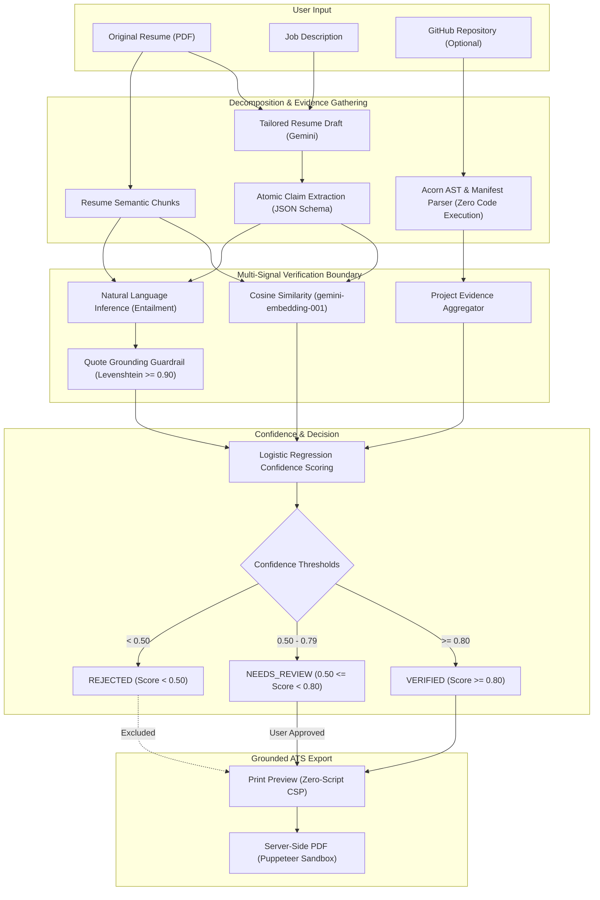

# JobFitAI v2

> **Grounded AI Resume Tailoring & Verification Pipeline**  
> Protects candidates and hiring managers by placing an automated, multi-signal verification boundary between generative LLMs and the exported resume.

---

## 1. Project Overview & Pitch

Generative AI models excel at phrasing resume bullet points to align with job descriptions. However, standard LLM-based resume builders frequently hallucinate achievements, skills, metrics, and project contributions that the candidate never performed.

**JobFitAI v2** solves this fundamental truthfulness problem. Instead of blindly trusting LLM generation:
1. It decomposes generated bullets into **atomic factual claims**.
2. It retrieves source evidence from original resumes and **static AST analysis of connected GitHub repositories**.
3. It validates each claim using multi-stage natural language inference (NLI), quote grounding, and cosine embedding similarity.
4. It computes a calibrated **confidence score** and strictly excludes unverified or rejected claims from the exported ATS resume.

---

## 2. System Architecture



---

## 3. Implemented Features

- **Multi-Signal Fact Verification**: Evaluates claims across three independent evidence classes (self-report resume, dependency manifests, and static AST code structures).
- **Prompt & Contradiction Defense**: Defends against prompt injection within job descriptions and adversarial README instructions. Contradictory evidence overrides self-reported claims.
- **Quote Grounding Guardrails**: Normalizes and asserts verbatim quote overlap between NLI entailment quotes and source text (Levenshtein similarity $\ge 0.90$).
- **Background Job Execution & Polling**: High-performance TanStack Query polling (`2s` intervals) over stateless job state collections with replica-set transaction rollback resilience.
- **Interactive Verification Workbench**: Interactive claim inspection UI displaying provenance, confidence scores, evidence snippets, and manual user override decisions (`approved` / `rejected`).
- **Grounded Resume Export**:
  - Zero-script Content Security Policy (CSP) print preview export.
  - Server-side headless Puppeteer PDF rendering with network egress interception.
- **Budget Guards & Quota Protection**:
  - Enforces per-user verification limits (`USER_DAILY_VERIFICATIONS=3`).
  - Enforces global generation limits (`LLM_DAILY_BUDGET=400`) and embedding limits (`EMBEDDING_DAILY_BUDGET=800`) counted since midnight Pacific (`America/Los_Angeles`).
  - Returns `429 DAILY_BUDGET_REACHED` before calling external AI APIs when quotas are reached.
- **Production Hardening**: SameSite `Lax` session cookies, reverse-proxy trust (`trust proxy: 1`), registration invitation lock, and rate limiting.

---

## 4. Running Locally

### Prerequisites
- Node.js $\ge 22.0.0$
- MongoDB $\ge 6.0$ (local standalone, replica set, or MongoDB Atlas)
- Google Gemini API key (from [Google AI Studio](https://aistudio.google.com/))

### Option A: Running with Docker Compose (One-Command)
```bash
# Clone the repository
git clone https://github.com/your-username/JobFitAI.git
cd JobFitAI

# Set your Gemini API key in the environment
export GOOGLE_GENAI_API_KEY="your-gemini-api-key"

# Start backend API and Mongo containers
docker compose up --build
```
The API is available at `http://localhost:3000` (`/health` and `/ready`).

### Option B: Running without Docker

#### 1. Backend Setup
```bash
cd Backend
cp .env.example .env
# Edit .env with your MONGO_URI, JWT_SECRET, and GOOGLE_GENAI_API_KEY

npm install
npm run dev
```

#### 2. Frontend Setup
```bash
cd ../Frontend
cp .env.example .env
npm install
npm run dev
```
Open `http://localhost:5173` in your browser.

---

## 5. Configuration Reference

### Backend Configuration (`Backend/.env`)

| Variable | Default | Purpose |
| :--- | :--- | :--- |
| `NODE_ENV` | `development` | Runtime environment (`development`, `test`, `production`) |
| `PORT` | `3000` | Port Express listens on |
| `FRONTEND_URL` | `http://localhost:5173` | Allowed CORS origin |
| `TRUST_PROXY_HOPS` | `1` | Number of upstream reverse proxy hops (1 for Render/Cloudflare, 2 if Vercel/Netlify proxies to Render) |
| `MONGO_URI` | *Required* | MongoDB connection string |
| `JWT_SECRET` | *Required ($\ge 32$ chars)* | HMAC secret for signing session tokens |
| `GOOGLE_GENAI_API_KEY` | *Required* | Google AI Studio API key |
| `GEMINI_MODEL` | `gemini-3.5-flash-lite` | Pinned generation model |
| `EMBEDDING_MODEL` | `gemini-embedding-001` | Pinned embedding model |
| `REGISTRATION_OPEN` | `true` (dev) / `false` (prod) | Whether public user sign-ups are allowed |
| `INVITE_CODE` | *Optional* | Code required for registration when closed |
| `USER_DAILY_VERIFICATIONS` | `3` | Max verification runs allowed per user per day |
| `LLM_DAILY_BUDGET` | `400` | Max LLM generation calls allowed per day |
| `EMBEDDING_DAILY_BUDGET` | `800` | Max embedding API calls allowed per day |
| `PDF_RENDERING_ENABLED` | `true` (dev) / `false` (prod) | Enables server-side Puppeteer rendering |

### Frontend Configuration (`Frontend/.env`)

| Variable | Default | Purpose |
| :--- | :--- | :--- |
| `VITE_API_URL` | `""` (empty) | Base URL for API requests. Empty string uses same-origin `/api` proxy |
| `VITE_API_BASE_URL` | `""` (empty) | Alternative alias for deployment hosts |

---

## 6. Testing & Evaluation

### Backend Test Suite
```bash
cd Backend

# Run unit and integration tests (in-memory MongoDB & ReplicaSet)
npm test

# Run linter
npx oxlint src/v2 test/v2
```

### Frontend Test Suite
```bash
cd Frontend

# Run React component and unit tests
npm test

# Run frontend linter
npm run lint

# Build production bundle
npm run build
```

### Offline Evaluation Harness
Run the offline evaluation runner against recorded benchmark test splits with zero live API calls:
```bash
cd Backend
node ../evaluation/scripts/eval-runner.js --config ../evaluation/configs/ablation-d-ci.json --limit 5
```

---

## 7. Security Notes

- **Zero-Script Content Security Policy**: Print preview templates enforce `default-src 'none'; style-src 'unsafe-inline'` to completely mitigate Stored XSS from adversarial resume text.
- **SSRF & Network Isolation**: Headless Puppeteer adapters employ Chrome DevTools Protocol request interception to abort all outbound HTTP/HTTPS egress and block access to private/cloud metadata IP addresses (`169.254.169.254`, `127.0.0.1`, RFC1918 subnets).
- **Static Code Analysis Only**: GitHub evidence extraction parses manifests (`package.json`, `requirements.txt`) and Acorn AST syntax trees in read-only memory. Never runs `eval()`, tests, or arbitrary shell commands.
- **No Token or Resume Logging**: Structured Pino logs sanitize user tokens, environment secrets, and personal resume text.
- **Ownership (IDOR) Protection**: All verification runs, drafts, and claims enforce object ownership validation, returning `404 Not Found` (rather than `403`) to avoid confirming entity existence.

---

## 8. Limitations & Methodology Caveats

- **Synthetic Benchmark Data**: All benchmark examples in `evaluation/data/` were synthetically constructed to systematically stress test edge cases and adversarial scenarios. None are derived from real personal resumes.
- **Labels by Construction**: Ground-truth labels were assigned by structural construction (e.g., deliberately omitting an entity or injecting an adversarial tag) rather than independent multi-annotator consensus.
- **No Independent Human Spot-Check**: Labels were generated and verified using programmatic checks and AI second-pass spot checks; they have not undergone double-blind human annotation.
- **TEST Split Modified After Inspection**: During Milestone 6 evaluation, the TEST split was inspected and adjusted to resolve injection control alignment. Consequently, reported TEST metrics must be treated as development benchmark results rather than an uncontaminated held-out test split.
- **Ceiling Effect**: Due to synthetic test case clarity, Ablations B, C, and D achieve identical 0.0% leak rates and identical precision on the TEST split, creating a ceiling effect where subtle differences between intermediate defenses are indistinguishable.
- **Syntactic AST Scope**: Static AST analysis identifies declared imports, exports, functions, and method calls in JavaScript and Python. It does not evaluate dynamic runtime behaviors, compiled binaries, or containerized execution.
- **Quantitative Metrics Verification**: Static code inspection cannot verify ungrounded percentage metrics (e.g., "improved latency by 45%") without production runtime APM logs.
- **Free-Tier Rate Limits**: Pinned to Google Gemini Flash Lite (15 RPM / 500 RPD) to guarantee reproducible runs within free-tier quotas.

---

## 9. Evaluation Results

Detailed benchmark evaluation reports produced by the offline evaluation harness are available in the [`evaluation/reports/`](evaluation/reports/) directory.

### Performance on Benchmark TEST Split (56 Cases — Synthetic, Labels by Construction)

> **Important Caveat**: Numbers reflect synthetic test cases with labels assigned by construction. The TEST split was inspected during development and exhibits ceiling effects across ablations; treat these as development benchmarks rather than an independent held-out evaluation.

| Pipeline Configuration | Precision | Recall | F1 Score | Leak Rate | ECE | Report |
| :--- | :---: | :---: | :---: | :---: | :---: | :--- |
| **Ablation A** (Similarity only) | 68.2% | 100.0% | 0.8108 | 31.8% | 0.3204 | [ablation-a-report.json](evaluation/reports/ablation-a-report.json) |
| **Ablation B** (+ Entailment) | 100.0% | 83.33% | 0.9091 | 0.0% | 0.3842 | [ablation-b-report.json](evaluation/reports/ablation-b-report.json) |
| **Ablation C** (+ Prompt Injection Defense) | 100.0% | 83.33% | 0.9091 | 0.0% | 0.3842 | [ablation-c-report.json](evaluation/reports/ablation-c-report.json) |
| **Ablation D** (+ Quote Grounding & Guardrails) | 100.0% | 66.67% | 0.8000 | 0.0% | 0.4254 | [ablation-d-report.json](evaluation/reports/ablation-d-report.json) |
| **Ablation E** (+ GitHub AST & Project Evidence) | **100.0%** | **66.67%** | **0.8000** | **0.0%** | **0.4254** | [ablation-e-report.json](evaluation/reports/ablation-e-report.json) |

*All reported numbers are calculated by the evaluation harness with 95% bootstrap confidence intervals across 1,000 resamples on synthetic cases. See [`evaluation/reports/`](evaluation/reports/) for per-case confusion matrices and calibration bin details.*
