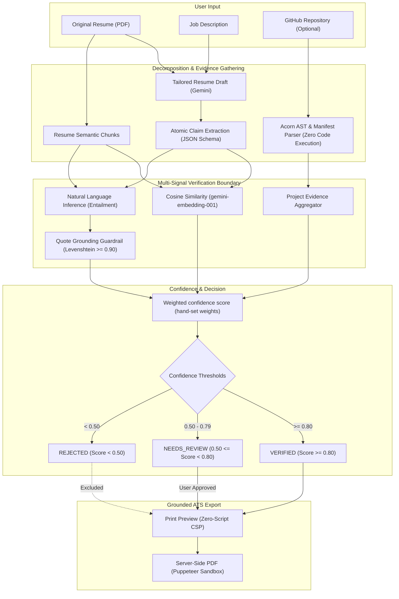

# JobFitAI v2

> **Grounded AI Resume Tailoring & Consistency-Checking Pipeline**  
> Places an automated, multi-signal check between a generative LLM and the exported resume, so that bullets the evidence you supplied does not support are left out.

> **What "verified" means here.** JobFitAI checks that an AI-written resume is *consistent with the resume text, self-description and (optionally) repositories you provide*. It does **not** independently verify facts such as employers, dates or metrics. Connecting GitHub shows that you *control* a repository; it does not prove that you *wrote* its code.

---

## At a Glance

JobFitAI has two parts that share one account system:

| Part | What it does |
| :--- | :--- |
| **V1: Interview prep** | Upload a resume PDF, paste a job description, and get a match score, technical and behavioral questions (with the interviewer's intention and how to answer), skill gaps with severity, and a day-wise preparation plan. |
| **V2: Grounded resume** | Generate a tailored resume draft, split it into atomic claims, check every claim against your own evidence with **retrieval-augmented verification** (embedding retrieval plus LLM entailment plus quote grounding), optionally add GitHub repository evidence, and export only what the evidence supports. |

**Stack:** React 19 + Vite, Node.js 22 + Express 5 (CommonJS), MongoDB (Mongoose), Google Gemini (generation and embeddings), Puppeteer (PDF), Zod, Pino, Vitest.

---

## 1. Project Overview & Pitch

Generative AI models excel at phrasing resume bullet points to align with job descriptions. However, standard LLM-based resume builders frequently hallucinate achievements, skills, metrics, and project contributions that the candidate never performed.

**JobFitAI v2** solves this fundamental truthfulness problem. Instead of blindly trusting LLM generation:
1. It decomposes generated bullets into **atomic factual claims**.
2. It retrieves source evidence (embedding search over your resume chunks, plus **static AST analysis of connected GitHub repositories**) for each claim. This is retrieval-augmented *verification*: retrieval is used to check the output, not to write it (the draft step reads the full resume text).
3. It validates each claim using multi-stage natural language inference (NLI), quote grounding, and cosine embedding similarity.
4. It computes a composite **confidence score** using hand-set production thresholds (the offline calibrated logistic regression model D-cal was evaluated and rejected) and strictly excludes unverified or rejected claims from the exported ATS resume.

---

## 2. System Architecture



---

## 3. Implemented Features

- **Multi-Signal Consistency Checking**: Evaluates claims across three evidence classes (your resume and self-description, dependency manifests, and static AST code structures). Repository evidence only counts toward the score when ownership of the repository is verified through GitHub Connect, and it only supports the claims of the draft project the repository belongs to (matched by name, or chosen by you). A repository never vouches for a different project, even one that uses the same technology.
- **GitHub Connect (GitHub App user authorization)**: Sign in with GitHub (PKCE + `state`, no repository permissions requested) to prove you own a public repository, select it, and analyze it. Tokens are encrypted at rest, never sent to the browser, refreshed automatically, and revocable (Disconnect). Private repositories are not supported in this version. Pasting a repository URL is not supported: repositories can only be added through GitHub Connect.
- **Complete Grounded Export**: Besides claim-checked bullets, the exported resume includes name, contact details, skills and education only when they appear in your resume; the AI-written summary is left out. Every dropped item is listed with a reason.
- **Best Projects for a Job**: after connecting GitHub, a background job analyses up to 15 of your public repositories (static analysis, nothing executed), skips any without a README and tells you so, extracts the job's requirements with one Gemini call, embeds the requirements and each repository's README, description and technology stack, and ranks the repositories by how well they cover what the job asks for. You see a strong/partial/weak match level and the actual passages that matched, then confirm or swap up to 4 projects. The scale was calibrated on real `gemini-embedding-001` vectors (unrelated text still scores about 0.8 cosine) using a small sample, so treat the levels as a guide.
- **GitHub Projects (retrieval before generation)**: once you confirm your best projects, `Generate Resume Draft` writes the Projects section from those repositories. For each one, the most relevant README passages for the job are retrieved, and the model writes 2-3 bullets from only those passages, citing them; it is told not to add numbers, metrics or technologies the README does not state, and a bullet that cites nothing real is dropped. Each bullet is then verified against the same repository's passages, never against your resume. You can rename a project, and it is only exported after you confirm `I built this project` (owning a repository does not show you wrote its code). Because the bullets are written from the same text they are checked against, verification here tests faithfulness to the README, not independent truth.
- **Links, Certifications and CGPA kept**: when you upload a PDF, its clickable labels (LinkedIn, GitHub, certificate links) are read together with their hidden URLs, and its Certifications / Achievements list and CGPA are copied word for word. They appear in the exported resume as real hyperlinks and text, written by code and never by the AI, so nothing can be invented. Only web (http/https) links are ever rendered as links.
- **Project naming**: a project heading such as `JobFitAI | React, Node.js` is split into a name and a technology list, and a technology the resume never mentions is dropped from the export. You can give any project tied to one of your repositories a different name; it is applied to the printed resume, together with a link to the repository.
- **Data Deletion**: Delete a plan (with its drafts, claims and jobs) or your whole account and all its data from the UI.
- **Prompt & Contradiction Defense**: Defends against prompt injection within job descriptions and adversarial README instructions. Contradictory evidence overrides self-reported claims.
- **Quote Grounding Guardrails**: Normalizes and asserts verbatim quote overlap between NLI entailment quotes and source text (Levenshtein similarity $\ge 0.90$).
- **Background Job Execution & Polling**: High-performance TanStack Query polling (`2s` intervals) over stateless job state collections with replica-set transaction rollback resilience.
- **Interactive Verification Workbench**: Interactive claim inspection UI displaying provenance, confidence scores, evidence snippets, and manual user override decisions (`approved` / `rejected`).
- **Grounded Resume Export**:
  - Zero-script Content Security Policy (CSP) print preview export.
  - Server-side headless Puppeteer PDF rendering with network egress interception.
- **Budget Guards & Quota Protection**:
  - Enforces per-user verification limits (`USER_DAILY_VERIFICATIONS=3`).
  - Enforces global generation limits (`LLM_DAILY_BUDGET=400`) and embedding limits (`EMBEDDING_DAILY_BUDGET=800`) counted since midnight Pacific (`America/Los_Angeles`).
  - Returns `429 DAILY_BUDGET_REACHED` before calling external AI APIs when quotas are reached.
- **Production Hardening**: SameSite `Lax` session cookies, reverse-proxy trust (`trust proxy: 1`), registration invitation lock, and rate limiting.

---

### 3.1 Interview Prep (V1)

- **Report generation**: resume PDF (text extracted server-side), optional self-description and a job description go to Gemini through the shared LLM client (timeout, retry, pacing, schema validation with one repair attempt, and an audit row per call). Resume and job text are passed as data, with instructions in them ignored.
- **Output**: match score (0-100), technical questions, behavioral questions (each with interviewer intention and how to answer), skill gaps with severity, and a 5-7 day preparation plan. A report is a coaching aid based only on what you supplied; it does not verify facts.
- **Accounts**: register, log in and log out with bcrypt-hashed passwords, an HTTP-only session cookie and a token blacklist on logout. Registration can be closed behind an invite code.
- **Management**: list and reopen past plans, delete a plan, or delete your account and all its data.
- **Protection**: Zod request validation, per-route rate limits, a per-user daily report cap (`USER_DAILY_REPORTS`), a global daily AI budget, and a per-user lock that returns `409 REQUEST_IN_PROGRESS` instead of running two reports at once.
- **Legacy PDF**: the old V1 resume-PDF download still exists and is scheduled for removal in favor of the V2 grounded export.
- A full report takes about 30 seconds on the real API, so the V1 report client uses a 90-second timeout (`V1_REPORT_TIMEOUT_MS`).
- If Google answers 503 "high demand" for the main model after three retries, the client tries `GEMINI_FALLBACK_MODEL` (default `gemini-3.5-flash`, slower, about 70 seconds per report) once. Set it to `none` to disable. Bad requests, quota errors and schema failures never use the fallback.

### 3.2 Retrieval and Verification Pipeline (V2)

1. **Draft**: Gemini writes a tailored, structured resume draft from the resume, optional self-description and the job description.
2. **Claim extraction**: each bullet is split into atomic, checkable claims (JSON schema output).
3. **Chunking and embedding**: the resume text is split into chunks and embedded with `gemini-embedding-001` (768 dimensions). Embeddings are cached in MongoDB. There is no separate vector database; cosine similarity is computed in the application.
4. **Retrieval**: for each claim, the top evidence chunks (`MAX_EVIDENCE_CHUNKS`, default 3) are selected by cosine similarity.
5. **Entailment**: Gemini judges only the retrieved evidence and answers yes, partial or no for each claim, with a supporting quote.
6. **Quote grounding**: the quote must appear in the source text (Levenshtein similarity of at least 0.90), otherwise the verdict is not trusted.
7. **GitHub evidence** (optional): dependencies and code structure from a verified-owned public repository count as additional evidence, but only for the claims of the project that repository belongs to. Experience (work) bullets never use repository evidence.
8. **Score and decision**: a weighted confidence score (similarity 0.30, entailment 0.40, project evidence 0.30; without GitHub 0.40 and 0.60) is mapped to `verified` (at least 0.80), `needs_review` (0.50 to 0.80) or `rejected` (below 0.50). You can approve or reject items manually before export.
9. **Export**: only verified (and user-approved) content is exported, bound to the exact draft the verification run checked.

Long-running steps run as background jobs that the UI polls. Jobs interrupted by a restart are marked failed on the next start instead of staying queued forever.

### 3.3 Tech Stack

| Layer | Technology |
| :--- | :--- |
| Frontend | React 19, Vite, React Router (lazy routes), TanStack Query, Axios |
| Backend | Node.js 22, Express 5, Zod validation, Pino logging, Helmet, express-rate-limit |
| Data | MongoDB with Mongoose (users, reports, drafts, claims, runs, jobs, LLM call audit log, embedding cache, GitHub connections) |
| AI | Google Gemini for structured generation and entailment, `gemini-embedding-001` for retrieval |
| Export | Puppeteer (headless Chromium) with request interception, zero-script CSP print view |
| Code analysis | Acorn AST and manifest parsing for GitHub repositories (no code is executed) |
| Quality | Vitest (backend and frontend), oxlint, GitHub Actions CI with an offline evaluation replay |

### 3.4 API Overview

All routes are under `/api`. Session cookie required except register and login.

| Area | Routes |
| :--- | :--- |
| Auth | `POST /auth/register`, `POST /auth/login`, `POST /auth/logout`, `GET /auth/get-me`, `DELETE /auth/account` |
| Interview reports (V1) | `POST /interview`, `GET /interview`, `GET /interview/report/:id`, `DELETE /interview/report/:id`, `POST /interview/resume/pdf/:id` (legacy) |
| Drafts and export (V2) | `POST /v2/drafts/:reportId`, `GET /v2/drafts/:reportId`, `GET /v2/drafts/:reportId/print`, `POST /v2/drafts/:reportId/pdf`, `GET /v2/drafts/:reportId/grounded` |
| Verification (V2) | `POST /v2/verification/:reportId`, `GET /v2/verification/:reportId`, `GET` and `PATCH /v2/verification/claim/:claimId` |
| Jobs | `GET /v2/jobs/:id` |
| GitHub projects | `PATCH /v2/github/links/:analysisId/details` (body: `reportId` and `displayName` and/or `authorshipConfirmed`); `POST /v2/drafts/:reportId` also returns `githubProjects` |
| Best projects | `POST /v2/github/ranking/:reportId` (starts a job), `GET /v2/github/ranking/:reportId`, `PUT /v2/github/ranking/:reportId/selection` (body: `repoIds`) |
| GitHub | `GET /v2/github/connection`, `POST /v2/github/connect/start`, `GET /v2/github/connect/callback`, `GET /v2/github/repos`, `DELETE /v2/github/connection`, `POST /v2/github/analyze` (body: `reportId`, `repoId`), `GET /v2/github/analysis/:id`, `GET /v2/github/links/:reportId`, `PUT /v2/github/links/:analysisId/project` |
| Health | `GET /v2/health`, `/health`, `/ready` |

Errors use one shape: `{ message, error: { code, message, requestId } }`.

---

## 4. Running Locally

### Prerequisites
- Node.js $\ge 22.0.0$
- MongoDB $\ge 6.0$ (local standalone, replica set, or MongoDB Atlas)
- Google Gemini API key (from [Google AI Studio](https://aistudio.google.com/))

### Option A: Running with Docker Compose (One-Command)
```bash
# Clone the repository
git clone https://github.com/fun-s-dev/JobFitAI.git
cd JobFitAI

# Set your Gemini API key in the environment
export GOOGLE_GENAI_API_KEY="your-gemini-api-key"

# Start backend API and Mongo containers
docker compose up --build
```
The API is available at `http://localhost:3000` (`/health` and `/ready`).

### Option B: Running without Docker

#### 1. Backend Setup
```bash
cd Backend
cp .env.example .env
# Edit .env with your MONGO_URI, JWT_SECRET, and GOOGLE_GENAI_API_KEY

npm install
npm run dev
```

#### 2. Frontend Setup
```bash
cd ../Frontend
cp .env.example .env
npm install
npm run dev
```
Open `http://localhost:5173` in your browser.

---

### Deploying (Vercel frontend + Render backend)

1. **Database**: create a MongoDB Atlas cluster and allow network access from the host (Render's outbound addresses change).
2. **Backend (Render)**: create a Docker web service from the `Backend` directory. Set `NODE_ENV=production`, `PUPPETEER_NO_SANDBOX=true`, `FRONTEND_URL` (the Vercel URL), `MONGO_URI`, `JWT_SECRET`, `GOOGLE_GENAI_API_KEY`, `REGISTRATION_OPEN` and `INVITE_CODE`, plus the four `GITHUB_APP_*` values if you use GitHub Connect. Set `TRUST_PROXY_HOPS=2` when Vercel proxies to Render.
3. **Frontend (Vercel)**: import the repo with root directory `Frontend`, and replace `BACKEND_URL_HERE` in `Frontend/vercel.json` with the Render host. The rewrite keeps `/api` same-origin so the session cookie works.
4. **GitHub App**: add `https://<frontend-domain>/api/v2/github/connect/callback` as a callback URL and use the same value for `GITHUB_APP_CALLBACK_URL`.
5. Free hosting tiers sleep when idle, and Chromium may need more memory than a 512 MB instance for PDF export.

---

## 5. Configuration Reference

### Backend Configuration (`Backend/.env`)

| Variable | Default | Purpose |
| :--- | :--- | :--- |
| `NODE_ENV` | `development` | Runtime environment (`development`, `test`, `production`) |
| `PORT` | `3000` | Port Express listens on |
| `FRONTEND_URL` | `http://localhost:5173` | Allowed CORS origin |
| `TRUST_PROXY_HOPS` | `1` | Number of upstream reverse proxy hops (1 for Render/Cloudflare, 2 if Vercel/Netlify proxies to Render) |
| `MONGO_URI` | *Required* | MongoDB connection string |
| `JWT_SECRET` | *Required ($\ge 32$ chars)* | HMAC secret for signing session tokens |
| `GOOGLE_GENAI_API_KEY` | *Required* | Google AI Studio API key |
| `GEMINI_MODEL` | `gemini-3.5-flash-lite` | Pinned generation model |
| `EMBEDDING_MODEL` | `gemini-embedding-001` | Pinned embedding model |
| `REGISTRATION_OPEN` | `true` (dev) / `false` (prod) | Whether public user sign-ups are allowed |
| `INVITE_CODE` | *Optional* | Code required for registration when closed |
| `USER_DAILY_VERIFICATIONS` | `3` | Max verification runs allowed per user per day |
| `LLM_DAILY_BUDGET` | `400` | Max LLM generation calls allowed per day |
| `EMBEDDING_DAILY_BUDGET` | `800` | Max embedding API calls allowed per day |
| `PDF_RENDERING_ENABLED` | `true` (dev) / `false` (prod) | Enables server-side Puppeteer rendering |
| `GITHUB_APP_CLIENT_ID`, `GITHUB_APP_CLIENT_SECRET`, `GITHUB_APP_CALLBACK_URL`, `GITHUB_TOKEN_ENC_KEY` | *Optional as a group* | Enable GitHub Connect. If any is set all four must be valid; the callback must end with `/api/v2/github/connect/callback`; the key is base64 of 32 random bytes. See `Backend/.env.example` |
| `USER_DAILY_REPORTS`, `USER_DAILY_GITHUB_ANALYSES` | `10`, `20` | Per-user daily caps for AI report requests and GitHub analyses |
| `RATE_LIMIT_*` | see `.env.example` | Per-window limits for login, sign-up, reports, exports and GitHub requests |
| `USER_DAILY_RANKINGS`, `RANKING_MAX_REPOS`, `RANKING_TOP_N` | `5`, `15`, `4` | Project ranking: daily runs per user, repositories analysed per run, projects that can be selected |
| `JOB_RETENTION_DAYS` | `30` | Finished background jobs are deleted automatically after this many days |

### Frontend Configuration (`Frontend/.env`)

| Variable | Default | Purpose |
| :--- | :--- | :--- |
| `VITE_API_URL` | `""` (empty) | Base URL for API requests. Empty string uses same-origin `/api` proxy |
| `VITE_API_BASE_URL` | `""` (empty) | Alternative alias for deployment hosts |

---

## 6. Testing & Evaluation

### Backend Test Suite
```bash
cd Backend

# Run unit and integration tests (in-memory MongoDB & ReplicaSet; 584 tests, no network or Gemini calls)
npm test

# Run linter
npx oxlint src/v2 test/v2
```

### Frontend Test Suite
```bash
cd Frontend

# Run React component and unit tests (78 tests)
npm test

# Run frontend linter
npm run lint

# Build production bundle
npm run build
```

### Offline Evaluation Harness
Run the offline evaluation runner against recorded benchmark test splits with zero live API calls:
```bash
cd Backend
node ../evaluation/scripts/eval-runner.js --config ../evaluation/configs/ablation-d-ci.json --limit 5
```

---

## 7. Security Notes

- **Zero-Script Content Security Policy**: Print preview templates enforce `default-src 'none'; style-src 'unsafe-inline'` to completely mitigate Stored XSS from adversarial resume text.
- **SSRF & Network Isolation**: Headless Puppeteer adapters employ Chrome DevTools Protocol request interception to abort all outbound HTTP/HTTPS egress and block access to private/cloud metadata IP addresses (`169.254.169.254`, `127.0.0.1`, RFC1918 subnets).
- **Static Code Analysis Only**: GitHub evidence extraction parses manifests (`package.json`, `requirements.txt`) and Acorn AST syntax trees in read-only memory. Never runs `eval()`, tests, or arbitrary shell commands.
- **No Token or Resume Logging**: Structured Pino logs sanitize user tokens, environment secrets, and personal resume text.
- **Ownership (IDOR) Protection**: All verification runs, drafts, and claims enforce object ownership validation, returning `404 Not Found` (rather than `403`) to avoid confirming entity existence.

---

## 8. Limitations & Methodology Caveats

- **Synthetic Benchmark Data**: All benchmark examples in `evaluation/data/` were synthetically constructed to systematically stress test edge cases and adversarial scenarios. None are derived from real personal resumes.
- **Labels by Construction**: Ground-truth labels were assigned by structural construction (e.g., deliberately omitting an entity or injecting an adversarial tag) rather than independent multi-annotator consensus.
- **No Independent Human Spot-Check**: Labels were generated and verified using programmatic checks and AI second-pass spot checks; they have not undergone double-blind human annotation.
- **TEST Split Modified After Inspection**: During Milestone 6 evaluation, the TEST split was inspected and adjusted to resolve injection control alignment. Consequently, reported TEST metrics must be treated as development benchmark results rather than an uncontaminated held-out test split.
- **Ceiling Effect**: Due to synthetic test case clarity, Ablations B, C, and D achieve identical 0.0% leak rates and identical precision on the TEST split, creating a ceiling effect where subtle differences between intermediate defenses are indistinguishable.
- **Syntactic AST Scope**: Static AST analysis identifies declared imports, exports, functions, and method calls in JavaScript (via Acorn). It does not evaluate dynamic runtime behaviors, compiled binaries, or containerized execution.
- **Quantitative Metrics Verification**: Static code inspection cannot verify ungrounded percentage metrics (e.g., "improved latency by 45%") without production runtime APM logs.
- **No Real-Draft Fabrication Study Yet**: The benchmark uses synthetic cases. How often real Gemini drafts contain unsupported claims, and how well the pipeline catches them on real resumes, has not been measured.
- **Private Repositories and Authorship**: GitHub Connect covers public repositories you own. It proves control of a repository, not authorship of its code.
- **Free-Tier Rate Limits**: Pinned to Google Gemini Flash Lite (15 RPM / 500 RPD) to guarantee reproducible runs within free-tier quotas.

---

## 9. Evaluation Results

Detailed benchmark evaluation reports produced by the offline evaluation harness are available in the [`evaluation/reports/`](evaluation/reports/) directory.

### Benchmark Composition

The evaluation benchmark contains 196 synthetically constructed test cases spanning 14 balanced categories (14 cases per category) created across project milestones:

| Benchmark Subset | Cases ($n$) | Description & Composition |
| :--- | :---: | :--- |
| **Base Resume Cases** | 126 | 9 core claim categories (14 cases each): supported, paraphrased, partial, number-changed, technology-swapped, role-inflated, metric-fabricated, fully-fabricated, and prompt-injection |
| **Adversarial Controls** | 14 | Security-related control texts lacking adversarial instructions, testing defense false-positive specificity |
| **GitHub-Backed Cases** | 56 | 4 repository evidence categories added in M9 (14 cases each): dependency-only, readme-only, source-confirmed, and readme-injection |
| **Total Benchmark** | **196** | 14 categories $\times$ 14 synthetic cases (`evaluation/data/cases.jsonl`), stratified into TRAIN/CV (71.4%) and TEST (28.6%) |
| **TRAIN / 5-Fold CV Split** | 140 | 10 cases per category $\times$ 14 categories (`evaluation/data/train.jsonl`); 112 non-supported cases (98 unsupported + 14 controls) and 28 supported cases |
| **M6 TEST Split (Initial)** | 36 / 40 | Initial M6 held-out test split (4 cases $\times$ 9 base categories = 36 cases, or 40 cases including 4 injection controls) |
| **Held-Out TEST Split (Final)** | **56** | 4 cases per category $\times$ 14 categories (`evaluation/data/test.jsonl`): 12 supported claims + 44 non-supported claims |

### Performance on Benchmark TEST Split (56 Cases — Synthetic, Labels by Construction)

> **Important Caveat**: Numbers reflect synthetic test cases with labels assigned by construction. The TEST split was inspected during development and exhibits ceiling effects across ablations; treat these as development benchmarks rather than an independent held-out evaluation.

| Pipeline Configuration | Precision | Recall | F1 Score | Leak Rate | ECE | Report |
| :--- | :---: | :---: | :---: | :---: | :---: | :--- |
| **Ablation A** (Similarity only) | 27.5% | 91.7% | 0.4231 | 62.5% | 0.6724 | [ablation-a-report.json](evaluation/reports/ablation-a-report.json) |
| **Ablation B** (+ Entailment) | 100.0% | 66.7% | 0.8000 | 0.0%* | 0.2321 | [ablation-b-report.json](evaluation/reports/ablation-b-report.json) |
| **Ablation C** (Similarity + Entailment, no injection defense) | 100.0% | 66.7% | 0.8000 | 0.0%* | 0.3654 | [ablation-c-report.json](evaluation/reports/ablation-c-report.json) |
| **Ablation D** (+ Quote Grounding & Guardrails) | 100.0% | 66.7% | 0.8000 | 0.0%* | 0.3600 | [ablation-d-report.json](evaluation/reports/ablation-d-report.json) |
| **Ablation E** (+ GitHub AST & Project Evidence) | **100.0%** | **66.7%** | **0.8000** | **0.0%*** | **0.4254** | [ablation-e-report.json](evaluation/reports/ablation-e-report.json) |

**Understanding Recall (66.7%)**: On the 56-case TEST split, recall is plainly **66.7%** across all multi-signal ablations (B through E): exactly **8 of 12 supported claims** verify automatically ($\text{confidence} \ge 0.80$), while the remaining 4 supported claims are flagged for human review (`needs_review`) rather than being automatically approved. Zero supported claims are rejected by the pipeline, and candidates retain the ability to manually confirm reviewable items before export.

*\*Zero leaks observed on 44 synthetic non-supported test cases (0.0% empirical leak rate; Wilson 95% score interval upper bound: 8.03%, Rule of Three: 6.82%). Across 5-fold cross-validation on the 140-case training split ($n=112$ non-supported cases, comprising 98 unsupported claims and 14 injection controls), zero leaks were observed (Wilson 95% score interval upper bound: 3.32%, Rule of Three: 2.68% on all $n=112$ non-supported cases; or 3.06% when evaluated on the $n=98$ unsupported claims alone).*

*Adversarial injection sample size ($n$): On held-out TEST ($n=56$), 4 prompt injection cases (`prompt_injection`) and 4 README injection cases (`readme_injection`) were tested ($n=8$ adversarial cases total; $n=4$ resume prompt injections). Zero leaks were observed (0/4 resume prompt injections; Wilson 95% score interval upper bound: 48.99%, Rule of Three: 75.0%). Across the entire 196-case benchmark, 14 prompt injections and 14 README injections were evaluated ($n=28$ total adversarial cases), with zero leaks observed (0/14 resume prompt injections, Wilson 95% upper bound: 20.91%, Rule of Three: 21.43%; 0/28 combined injections, Wilson 95% upper bound: 11.35%, Rule of Three: 10.71%).*

*All reported numbers are calculated by the evaluation harness from raw predictions and verified against the report JSON artifacts. The numbers can be reproduced offline from the recorded model responses, with no Gemini calls: `cd Backend && node ../evaluation/scripts/eval-runner.js --config ../evaluation/configs/ablation-d-ci.json --replay-only` (it fails instead of calling Gemini if any recorded response is missing). Reproducing them shows the pipeline is deterministic on recorded outputs; it is not an independent validation of the model.*
